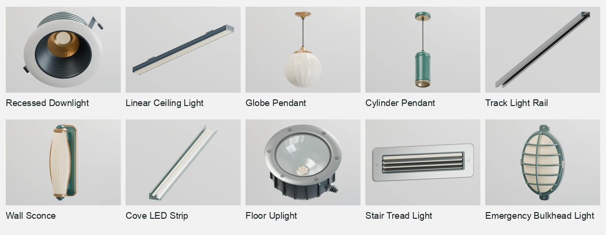

# Mall Architectural Lighting

Ten static, independently inspectable Blender fixtures for a retail interior. Each model directory contains the editable Blender 5.1.2 scene, a generator, both GLBs, rendered previews, mounting notes and asset rights. The gallery loads L0 when a visitor opens the model. L1 is available in the repository for mid-distance scene instances. [Open the collection](https://yapweijun1996.github.io/Blender-3D-Gallery/?page=models&collection=mall-architectural-lighting)



| Backlog ID | Model and source instructions | Editable meshes | L0 triangles | L1 triangles |
| --- | --- | ---: | ---: | ---: |
| `MALL-LGT-001` | [Recessed Downlight](../../../models/mall-recessed-downlight/README.md) | 22 | 11,080 | 2,912 |
| `MALL-LGT-002` | [Linear Ceiling Light](../../../models/mall-linear-ceiling-light/README.md) | 24 | 3,748 | 860 |
| `MALL-LGT-003` | [Globe Pendant](../../../models/mall-globe-pendant/README.md) | 11 | 9,240 | 2,640 |
| `MALL-LGT-004` | [Cylinder Pendant](../../../models/mall-cylinder-pendant/README.md) | 17 | 7,736 | 2,752 |
| `MALL-LGT-005` | [Track Light Rail](../../../models/mall-track-light-rail/README.md) | 19 | 804 | 518 |
| `MALL-LGT-007` | [Wall Sconce](../../../models/mall-wall-sconce/README.md) | 19 | 6,572 | 2,420 |
| `MALL-LGT-008` | [Cove LED Strip](../../../models/mall-cove-led-strip/README.md) | 110 | 4,172 | 312 |
| `MALL-LGT-009` | [Floor Uplight](../../../models/mall-floor-uplight/README.md) | 46 | 8,764 | 2,972 |
| `MALL-LGT-010` | [Stair Tread Light](../../../models/mall-stair-tread-light/README.md) | 19 | 2,404 | 1,268 |
| `MALL-LGT-011` | [Emergency Bulkhead Light](../../../models/mall-emergency-bulkhead-light/README.md) | 27 | 8,860 | 3,172 |

## Acceptance on 2026-11-17

- Reopened all ten native scenes. Their evaluated parts had closed, consistently wound edges and positive signed volumes. All ten saved sources re-exported byte-identical L0 files with Blender 5.1.2. A finish change on a scratch copy of the wall sconce survived export and reimport on the intended 476-triangle upper finial; all 6,572 triangle positions stayed the same.
- Verified all twenty GLBs with the locked Khronos validator. Each had zero errors and warnings, embedded resources and finite geometry. The topology scan found zero triangles at or below 10⁻¹² m² and finite unit normals. Both detail levels reopened in Blender with the intended root. L0 bounds matched the evaluated source and L1 used fewer triangles and bytes for every model. SHA-256 values, sizes and dimensions are in the [asset inventory](inventory.json).
- Inspected the gallery cards and reimported renders for framing, silhouette and visible optics. The rail and cove use oblique views to show their long profiles. Two 1.8 m rails and two differently aimed heads from the existing spotlight fit at stations 1.28 m apart. The measured body seam was 0.6 mm and the splice inserted 17.7 mm. [Assembly measurements and image](../../../models/mall-track-light-rail/README.md)
- The production build and all 741 project unit tests passed on Node.js 24.21.0. Chromium at 1440 × 900 and 390 × 844 showed all ten cards before fetching any model bytes. Opening each card loaded the matching L0 SHA-256 and issued a WebGL draw. Orbit and zoom changed each canvas, reset restored its initial pixels, and closing removed the canvas. These checks used desktop Chromium with software WebGL and viewport emulation. Physical phone performance, electrical installation and photometric output were outside the tests.

## Repeat the checks

From the repository root, use Node.js 24, the locked dependencies and Playwright Chromium. The browser command starts a local server for the production build and writes its screenshots to the specified directory.

```sh
npm ci
node scripts/scan-glb-topology.mjs docs/verification/mall-lighting-ten/inventory.json /tmp/mall-lighting-topology
npm test
npm run build
node scripts/test-mall-lighting-gallery.mjs /tmp/mall-lighting-browser
```

To reproduce a model, run the Blender command in its linked README. For the rail fit, run the dedicated assembly check with the existing spotlight source available.
