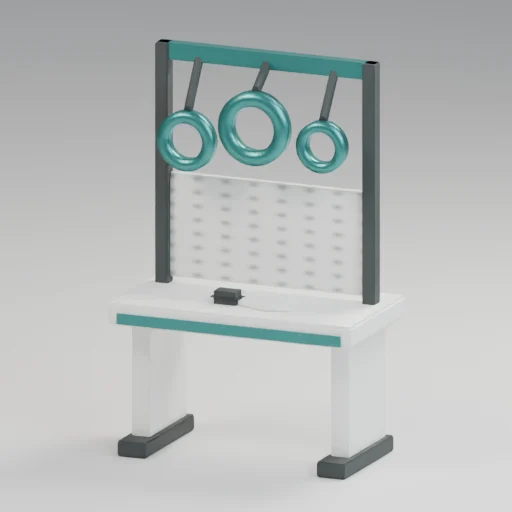

# Eyelet Rail

S16 · GP · Locator workshop. Perforated eyelet demonstration rail.

Bottom centre of the installed envelope, +Y up and +Z display front in glTF.

Low 544 triangles | Balanced 1,152 triangles | Detailed 1,600 triangles.

[Editable source](sources/eyelet-rail.blend) · [Generator](generate.py) · [Measurements and provenance](metadata/eyelet-rail.json) · [Rights](LICENSE.md)

[Build instructions and placement contract](../../docs/gjh-v11-interiors-build.md)
