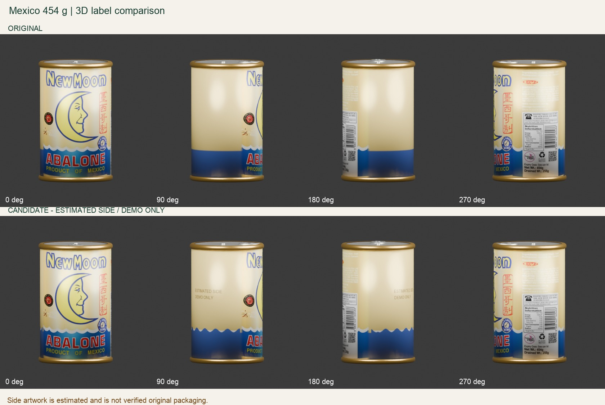

# Mexico abalone — estimated-side candidate

This is an **unofficial visual candidate**, not a verified or brand-approved replica. Approximately 121 degrees of the original Mexico 454 g LOD1 label lack matching side photography. This candidate extends the gold/blue border decoratively and marks the missing sector **ESTIMATED SIDE / DEMO ONLY**. The label's panel spacing is estimated and a small seam remains near the reverse panel. It does not invent product facts, logos, barcodes or certifications.



- [Candidate GLB](mexico-454g-estimated-side.glb): 274,648 bytes; SHA-256 `5279ae0e02db516c430c832e6c040f6f3187bd2649364763b888dddafe7cb717`.
- Original: [Mexico LOD1](../../exports/lod1/gjh-can-mexico-abalone-lod1.glb), SHA-256 `52f8952ca698cc77c6aaf8f1ef5c607a31c401817e6bf6741426e17510164acb`.
- Original geometry and the decoded known central label pixels remain unchanged. The candidate has 3 meshes and one 640 × 312 embedded PNG texture; it is larger than the 119,196-byte JPEG-textured original.
- Opened and rendered in Blender at 0°, 90°, 180° and 270°; GLB buffer bounds and non-image buffer bytes checked. Browser loading and real-device performance are not verified. The candidate is not registered in the gallery catalog and does not replace the original.
- Photo provenance, rights and original model limitations are documented in the [collection README](../../README.md) and [Mexico metadata](../../metadata/gjh-can-mexico-abalone.json). GJH/New Moon packaging artwork belongs to its respective owners; no general redistribution licence is implied.

## Reproduction

On macOS with Python 3, Pillow and the system Arial font installed, run from this directory:

```sh
python3 rebuild-estimated-side.py ../../exports/lod1/gjh-can-mexico-abalone-lod1.glb /tmp/mexico-454g-estimated-side.glb
shasum -a 256 /tmp/mexico-454g-estimated-side.glb
```

Reproduction was byte-for-byte checked on the author's macOS environment. Pillow, font and platform versions may affect output bytes. The comparison image is a Blender render, not product photography.
