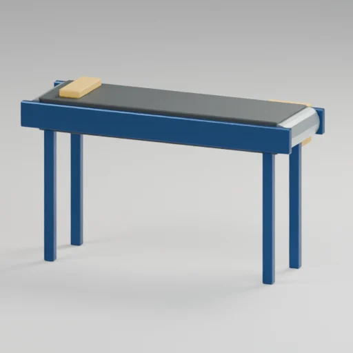

# Conveyor Belt · Canning-line grocer

S09 · SPAM · Canning-line grocer. Diagonal tinning conveyor.

Bottom centre of the installed envelope, +Y up and +Z display front in glTF.

Low 176 triangles | Balanced 560 triangles.

[Editable source](sources/gjh-conveyor-belt.blend) · [Generator](generate.py) · [Measurements and provenance](metadata/gjh-conveyor-belt.json) · [Rights](LICENSE.md)

[Build instructions and placement contract](../../docs/gjh-v11-interiors-build.md)
