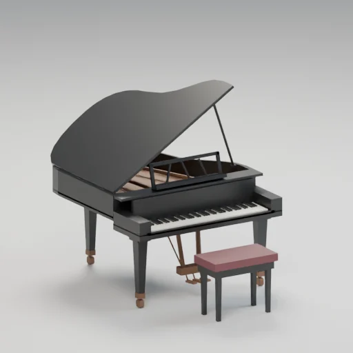

# Grand Piano · Chamber recital room

S15 · Casio · Chamber recital room. Open baby grand and bench on recital oval.

Bottom centre of the installed envelope, +Y up and +Z display front in glTF.

Low 912 triangles | Balanced 2,704 triangles.

[Editable source](sources/gjh-grand-piano.blend) · [Generator](generate.py) · [Measurements and provenance](metadata/gjh-grand-piano.json) · [Rights](LICENSE.md)

[Build instructions and placement contract](../../docs/gjh-v11-interiors-build.md)
