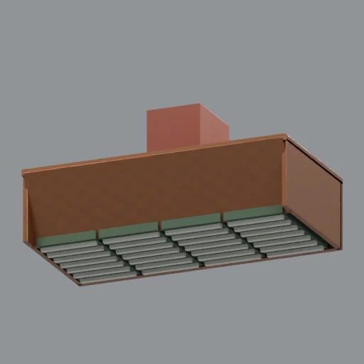

# Hawker Stall Exhaust Hood · Open noodle kitchen

S02 · MILI · Open noodle kitchen. Hammered-metal hood over the lacquer pass.

Bottom centre of the installed envelope, +Y up and +Z display front in glTF.

Low 468 triangles | Balanced 692 triangles.

[Editable source](sources/gjh-hawker-stall-exhaust-hood.blend) · [Generator](generate.py) · [Measurements and provenance](metadata/gjh-hawker-stall-exhaust-hood.json) · [Rights](LICENSE.md)

[Build instructions and placement contract](../../docs/gjh-v11-interiors-build.md)
