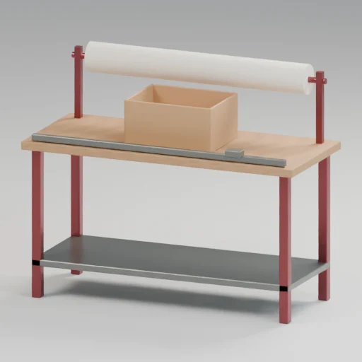

# Packing Station · Provision packing room

S11 · Hormel · Provision packing room. Wrapping station with a high kraft-roll rail.

Bottom centre of the installed envelope, +Y up and +Z display front in glTF.

Low 276 triangles | Balanced 748 triangles.

[Editable source](sources/gjh-packing-station.blend) · [Generator](generate.py) · [Measurements and provenance](metadata/gjh-packing-station.json) · [Rights](LICENSE.md)

[Build instructions and placement contract](../../docs/gjh-v11-interiors-build.md)
