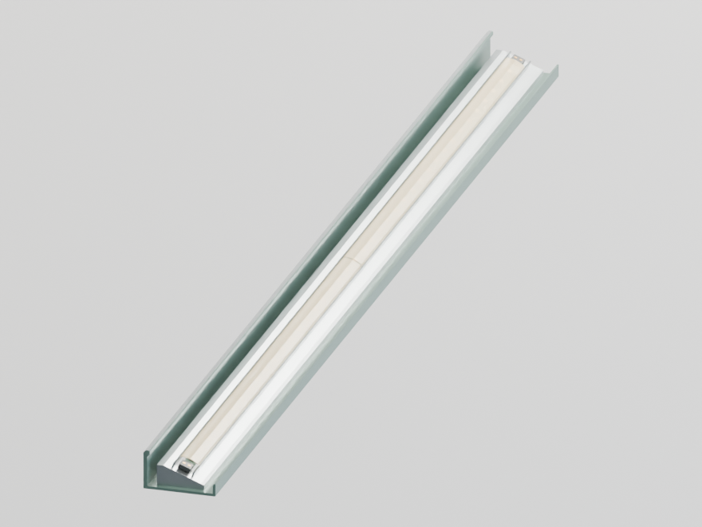

# Mall Cove LED Strip

This 2 m long recessed luminaire covers `MALL-LGT-008` in the [shopping mall backlog](../../docs/shopping-mall/production-backlog-v1.md). The celadon front fascia shields a sloping aluminium tray. Two replaceable opal diffuser lengths cover a sage ribbon populated with forty ceramic LED packages and their warm phosphor dies. Short terminal wells at either end leave the feed clamps accessible.



## Installation in a scene

Place the root on the cove ledge at Z = 0. The tall shield faces Blender −Y. The ribbon tilts 21.2° towards the rear wall at +Y. Place successive roots 2.000 m apart along X to align their square ends. The modeled section measures 130.1 mm across and 71.4 mm tall. The central 4 mm service joint divides the two optical covers.

The LEDs use an emissive material for their visible appearance. Supply a separate light in scenes that require a simulated wall wash. L1 keeps the trough, shield, optical covers and terminal wells, replacing the individual chips with one continuous emitter for distant views.

## Build and inspect

The [native source](sources/mall-cove-led-strip.blend) retains the cross-sections, individual chip packages, terminal hardware and covers. Run the following from the repository root using Blender 5.1.2. The build regenerates the source, [L0](exports/optimized.glb), [L1](exports/lod1.glb), hero and thumbnail. Append `-- --export-source` to export L0 from manually edited native parts.

```sh
blender --background --factory-startup --python-exit-code 1 --python models/mall-cove-led-strip/generate.py
```

[Metadata](metadata/mall-cove-led-strip.json) · [Asset rights](LICENSE.md)
