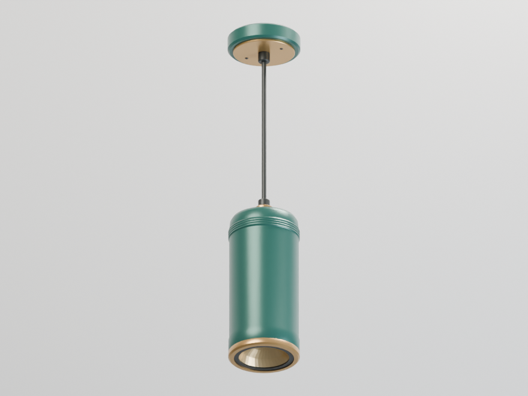

# Mall Cylinder Pendant

A bottle-green tubular pendant with a spun metal shade, ribbed shoulder, champagne ferrule and dark aperture. A recessed warm optic sits inside the open end.



## Placement

Place the upper face of the green canopy at Z = 0 on the ceiling underside. Its diameter is 92 mm and the brass outlet sits 447 mm below the mount. The cable follows local Z. Dimensions are in metres in Blender and glTF. The root is `ASSET_MallCylinderPendant`. This static asset depicts the lit surface. Add a scene light to illuminate surrounding geometry.

## Editing and rebuilding

1. Open [the native Blender file](sources/mall-cylinder-pendant.blend) in Blender 5.1.2. Components including `Enamelled shade` and `Gold reflector` are separate editable meshes.
2. To regenerate both detail levels and their previews, run the following from the repository root. The command uses the local profile and delivery helpers in `scripts/`. It writes the packaged files in this folder.

   ```sh
   blender --background -t 2 --factory-startup --python-exit-code 1 --python models/mall-cylinder-pendant/generate.py
   ```

3. To export a manually edited and saved source, append `-- --export-source` to that command. This updates the close-up GLB and preview. For durable changes to both levels, update [the generator](generate.py) and rebuild.

## Delivery

| File | Triangles | Bytes |
| --- | ---: | ---: |
| [Close-up GLB](exports/optimized.glb) | 7,736 | 234,168 |
| [Mid-distance GLB](exports/lod1.glb) | 2,752 | 88,892 |

Fewer barrel and reflector segments, two simplified shoulder beads, and fewer cosmetic fittings. The brass collar, lip and layered optic remain present. Both exports use 5 locally authored scalar PBR materials with no external textures. The preview is a Blender Cycles render of the imported close-up GLB. The gallery camera looks toward the model from glTF direction `[0.9, -0.78, 1.4]`.

This fixture implements `MALL-LGT-004` in the [mall production backlog](../../docs/shopping-mall/production-backlog-v1.md). [Asset rights](LICENSE.md).
