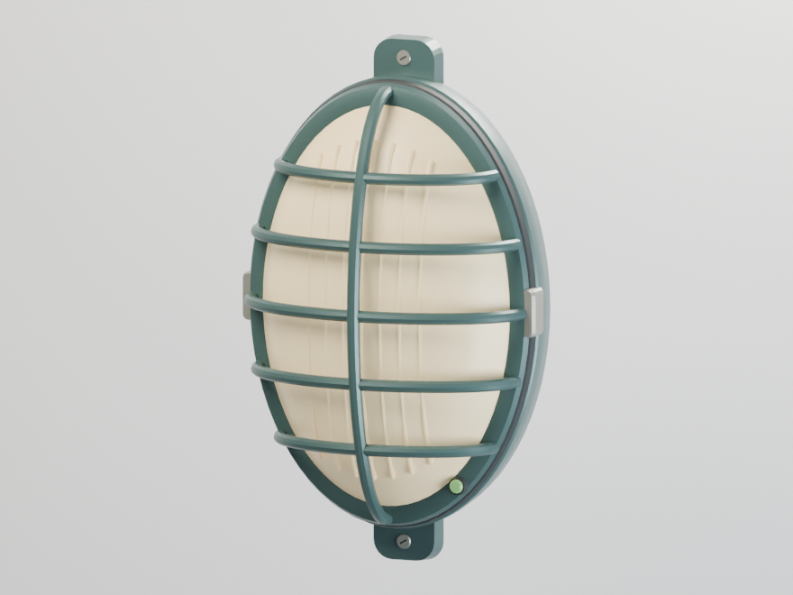

# Mall Emergency Bulkhead Light

A marine-teal oval casting holds an ivory prismatic globe behind five arched guard bars and a longitudinal spine. Captive side clasps, mounting ears, weatherseal and green pilot complete the assembly.



## Placement and materials

Align the rear face of the oval casting and mounting ears with the wall or ceiling. The long dimension follows local Blender Z and the optical face points toward −Y. The mount plane is Blender Y = 0 and glTF Z = 0. All dimensions are in metres. Marine teal enamel, warm ivory diffuser, charcoal seal, burnished nickel and a green pilot. Visual emergency luminaire with a static pilot. No backup-power, photometric, enclosure or compliance rating is specified.

## Measured geometry

The L0 envelope is 207 × 343 × 104 mm (width × height × depth). Both detail levels project 104 mm from the installation face. L1 retains all six protective bars and the gasket. It simplifies the ring profiles and omits the raised optical prisms and fastener slots.

| Export | Triangles | Bytes | Materials |
| --- | ---: | ---: | ---: |
| L0 | 8,860 | 265,376 | 5 |
| L1 | 3,172 | 99,608 | 5 |

## Rebuild

From the repository root, run the following with Blender 5.1.2.

```sh
blender -b -t 2 --factory-startup --python-exit-code 1 --python models/mall-emergency-bulkhead-light/generate.py
```

The [editable Blender file](sources/mall-emergency-bulkhead-light.blend) contains 27 separately editable mesh objects. Each evaluated mesh reopened with manifold edges and positive signed volume in Blender 5.1.2. Both GLBs passed the project’s Khronos validator with zero warnings or errors. [L0](exports/optimized.glb) is the gallery model and [L1](exports/lod1.glb) is the separately generated mid-distance model. The generator shares [procedural geometry](../../scripts/mall-wall-lights.py) and [delivery code](../../scripts/mall_lighting_delivery.py) with the lighting family. To export a manual edit from the saved source, append `-- --export-source` to the command. The asset contains original procedural geometry and texture-free materials. See [asset rights](LICENSE.md).
