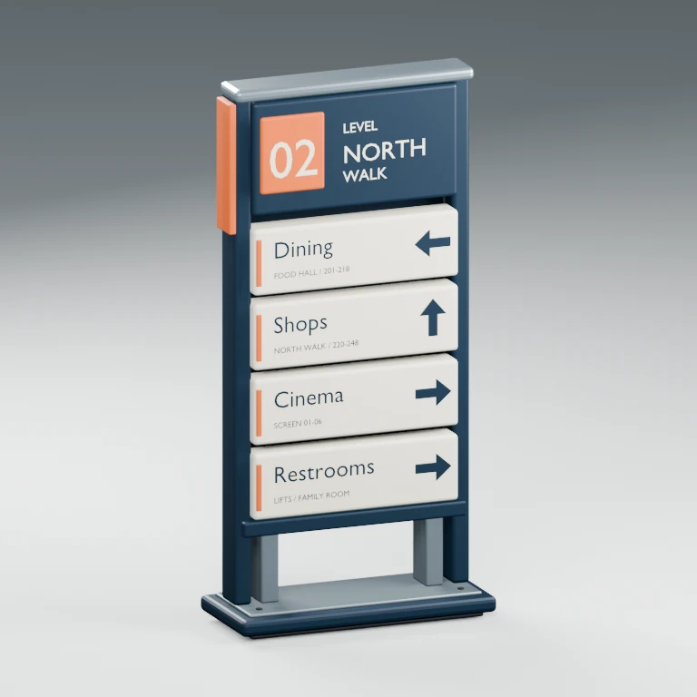

# Mall Floor Direction Sign

An original freestanding **North Walk / Level 02** wayfinding totem. Midnight-blue powder coat, porcelain-enamel cartridges, an orange level badge and satin aluminium details give the sign a distinct silhouette without textures.



## Delivered asset

- Editable Blender 4.0.2 source, standalone GLB, PNG and WebP previews.
- 1.24 × 0.54 × 2.53 m in Blender XYZ, with its origin at the floor centre.
- Front: Blender +Y / glTF -Z. The existing per-asset `previewRotationY: Math.PI` displays the front in the gallery; the viewer is unchanged.
- Six independent, real mesh-bearing GLB groups: `SignStructure`, `FloorIdentity`, `DirectionDining`, `DirectionShops`, `DirectionCinema`, and `DirectionFacilities`.
- Label replacements are **source-level**. The gallery provides viewing, orbit, zoom and reset, not live label editing.

## Edit labels or arrows

1. Open `sources/mall-floor-direction-sign.blend`.
2. Edit the FONT objects named “editable destination” and “editable detail” inside a directional collection. Edit the floor/zone FONT objects inside `FloorIdentity`. Adjust the real arrow mesh within that same cartridge if the route changes.
3. Save the source, then export the saved source without rebuilding:

   ```sh
   blender --background --python models/mall-floor-direction-sign/generate.py -- --export-source
   python3 models/mall-floor-direction-sign/prepare_previews.py
   node models/mall-floor-direction-sign/validate.mjs
   ```

The export evaluates bevels and fonts, then joins geometry **only within each semantic module**. The source text remains editable. Studio floor, lights and camera are excluded from the GLB. Long replacement text may need a smaller font or repositioning; there is no automatic text fitting.

After a custom edit, update `metadata/mall-floor-direction-sign.json` metrics and validation from `reports/assets.json` before running the catalog checks. The original source inspection expects the shipped labels and should be updated for an intentional new design.

## Rebuild the original design

The following recreates the canonical geometry and overwrites manual source edits. Save a separate copy first if needed.

```sh
blender --background --python models/mall-floor-direction-sign/generate.py
blender --background --python models/mall-floor-direction-sign/inspect_sources.py
python3 models/mall-floor-direction-sign/prepare_previews.py
node models/mall-floor-direction-sign/validate.mjs
npm test
npm run build
node scripts/test-mall-floor-direction-sign.mjs
npm run test:library
```

Use Blender 4.0.2, Python with Pillow, and Node 22 with the pinned project dependencies. The browser tests use Playwright Chromium. `MALL_QA_DIR` selects the focused browser artifact directory.

## Budgets and provenance

The measured export is 561,892 bytes, 13,404 triangles and 19 primitives. Nineteen primitives are an intentional exception to the preferred eight-primitive target: all six modules retain independent material slots. The 700 KB / 20,000-triangle limits remain satisfied. No textures, animations or external buffers are required.

All geometry, materials and labels are original to this project, using Blender's bundled Bfont. No external models, branded artwork or downloads are embedded. Reuse in the owner's projects is authorized; public redistribution terms have not been specified, so the gallery download control remains disabled. This is a decorative concept, not an official mall route plan, fabrication design, structural calculation or accessibility specification.

See [verification](verification.md) and the measured reports for exact evidence and limitations.
