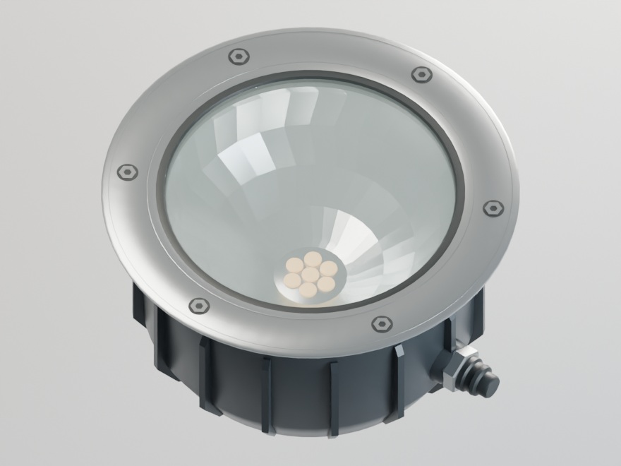

# Mall Floor Uplight

A recessed floor fixture for item `MALL-LGT-009` in the [shopping mall backlog](../../docs/shopping-mall/production-backlog-v1.md). A 216 mm stainless flange carries six inset hex fasteners around a glazed aperture. Seven warm emitters sit at the bottom of a staggered, radially faceted aluminium reflector. Cooling webs, the rear pot and a side-entry gland complete the below-floor housing.



## Installation in a scene

Place the root on the finished floor at Z = 0. The ribbed pot extends 112 mm below this level. The flange projects 3 mm above it, with the fastener heads reaching 3.45 mm. The cable gland faces local +X and extends the overall width to 226 mm. The visible face points along Blender +Z, which becomes glTF +Y. The top-down placement requires an opening in the host floor for the recessed optical face. The illustrative mounting dimensions do not specify walk-over load, waterproofing, electrical or photometric performance.

The slightly tinted cover is a transparent material. Directional lighting in the host scene supplies a visible beam when desired. L1 simplifies the optic, housing and hardware while retaining the hex fixing pattern and seven emitters.

## Build and inspect

The [native Blender source](sources/mall-floor-uplight.blend) retains individually editable components. In Blender 5.1.2, run the command from the repository root to produce the source, [close-up GLB](exports/optimized.glb), [mid-distance GLB](exports/lod1.glb), hero and thumbnail. Append `-- --export-source` to export L0 from a manually edited source.

```sh
blender --background --factory-startup --python-exit-code 1 --python models/mall-floor-uplight/generate.py
```

[Metadata](metadata/mall-floor-uplight.json) · [Asset rights](LICENSE.md)
