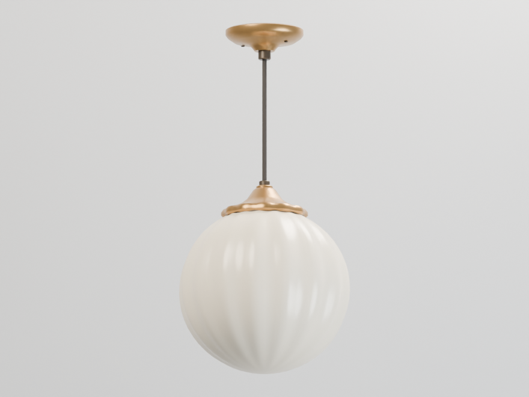

# Mall Globe Pendant

A moulded, sixteen-rib vanilla opaline globe supported by a scalloped brass gallery, dark textile flex and stepped ceiling rose. The fluting runs around the full glass body and changes the silhouette.



## Placement

Place the centre of the flat ceiling rose on the ceiling underside at Z = 0. The globe is 242.5 mm across its widest ribs in the close-up model. Its lowest point is 491 mm below the mount. Dimensions are in metres in Blender and glTF. The root is `ASSET_MallGlobePendant`. This static asset depicts the lit surface. Add a scene light to illuminate surrounding geometry.

## Editing and rebuilding

1. Open [the native Blender file](sources/mall-globe-pendant.blend) in Blender 5.1.2. Components including `Sixteen-rib opal globe` and `Scalloped brass crown` are separate editable meshes.
2. To regenerate both detail levels and their previews, run the following from the repository root. The command uses the local profile and delivery helpers in `scripts/`. It writes the packaged files in this folder.

   ```sh
   blender --background -t 2 --factory-startup --python-exit-code 1 --python models/mall-globe-pendant/generate.py
   ```

3. To export a manually edited and saved source, append `-- --export-source` to that command. This updates the close-up GLB and preview. For durable changes to both levels, update [the generator](generate.py) and rebuild.

## Delivery

| File | Triangles | Bytes |
| --- | ---: | ---: |
| [Close-up GLB](exports/optimized.glb) | 9,240 | 206,288 |
| [Mid-distance GLB](exports/lod1.glb) | 2,640 | 66,816 |

Fewer globe meridians and parallels, reduced moulding relief and simplified brass hardware. The fluted shade, crown and complete suspension remain present. Both exports use 4 locally authored scalar PBR materials with no external textures. The preview is a Blender Cycles render of the imported close-up GLB. The gallery camera looks toward the model from glTF direction `[0.85, -0.32, 1.5]`.

This fixture implements `MALL-LGT-003` in the [mall production backlog](../../docs/shopping-mall/production-backlog-v1.md). [Asset rights](LICENSE.md).
