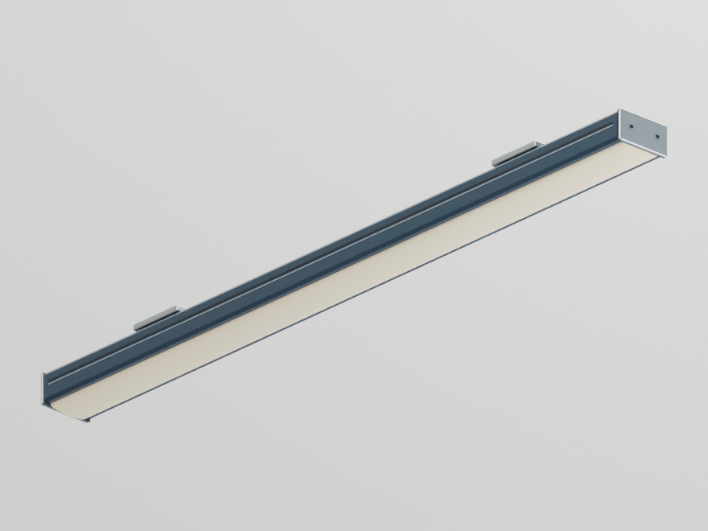

# Mall Linear Ceiling Light

A surface-mounted linear luminaire with a continuous warm opal cover, a night-blue extruded chassis, brushed pewter end cheeks and captive socket fasteners.



## Placement

Place the two fixing saddle tops on the ceiling underside at Z = 0. The long axis is Blender X. The overall end-to-end span is 1.2023 m including the projecting screw heads. The underside of the diffuser sits 69 mm below the mount. Dimensions are in metres in Blender and glTF. The root is `ASSET_MallLinearCeilingLight`. This static asset depicts the lit surface. Add a scene light to illuminate surrounding geometry.

## Editing and rebuilding

1. Open [the native Blender file](sources/mall-linear-ceiling-light.blend) in Blender 5.1.2. Components including `Continuous aluminium channel` and `Snap-in opal cover` are separate editable meshes.
2. To regenerate both detail levels and their previews, run the following from the repository root. The command uses the local profile and delivery helpers in `scripts/`. It writes the packaged files in this folder.

   ```sh
   blender --background -t 2 --factory-startup --python-exit-code 1 --python models/mall-linear-ceiling-light/generate.py
   ```

3. To export a manually edited and saved source, append `-- --export-source` to that command. This updates the close-up GLB and preview. For durable changes to both levels, update [the generator](generate.py) and rebuild.

## Delivery

| File | Triangles | Bytes |
| --- | ---: | ---: |
| [Close-up GLB](exports/optimized.glb) | 3,748 | 156,620 |
| [Mid-distance GLB](exports/lod1.glb) | 860 | 38,156 |

Single-segment hardware bevels, a coarser diffuser section and simplified extrusion details. The paired saddles, end screws and continuous lens remain present. Both exports use 4 locally authored scalar PBR materials with no external textures. The preview is a Blender Cycles render of the imported close-up GLB. The gallery camera looks toward the model from glTF direction `[1.4, -0.9, 1.3]`.

This fixture implements `MALL-LGT-002` in the [mall production backlog](../../docs/shopping-mall/production-backlog-v1.md). [Asset rights](LICENSE.md).
