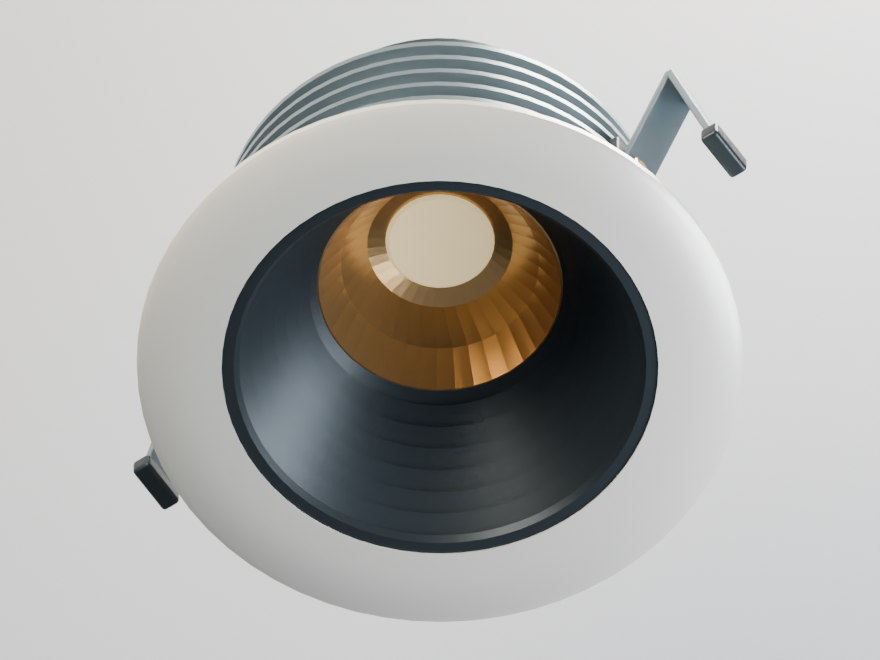

# Mall Recessed Downlight

A round recessed downlight with a porcelain trim, a deep graphite glare baffle and a champagne reflector. Opposed metal springs grip the ceiling above the flange. Fins and a rear service cover finish the hidden casting.



## Placement

Place the upper face of the porcelain flange at the finished ceiling underside (Blender Z = 0). The 150 mm trim covers the opening. The installed geometry reaches 91 mm into the void and 5.5 mm into the room. The two clips are shown spread to 175 mm. A mounting cutout, spring insertion motion and ceiling structure belong to the host scene. Dimensions are in metres in Blender and glTF. The root is `ASSET_MallRecessedDownlight`. This static asset depicts the lit surface. Add a scene light to illuminate surrounding geometry.

## Editing and rebuilding

1. Open [the native Blender file](sources/mall-recessed-downlight.blend) in Blender 5.1.2. Components including `Rolled plaster trim` and `Concentric glare baffle` are separate editable meshes.
2. To regenerate both detail levels and their previews, run the following from the repository root. The command uses the local profile and delivery helpers in `scripts/`. It writes the packaged files in this folder.

   ```sh
   blender --background -t 2 --factory-startup --python-exit-code 1 --python models/mall-recessed-downlight/generate.py
   ```

3. To export a manually edited and saved source, append `-- --export-source` to that command. This updates the close-up GLB and preview. For durable changes to both levels, update [the generator](generate.py) and rebuild.

## Delivery

| File | Triangles | Bytes |
| --- | ---: | ---: |
| [Close-up GLB](exports/optimized.glb) | 11,080 | 353,128 |
| [Mid-distance GLB](exports/lod1.glb) | 2,912 | 96,132 |

Fewer radial samples, cooling fins and glare serrations. The spring shoes, deployed clips, optic and mount remain present. Both exports use 5 locally authored scalar PBR materials with no external textures. The preview is a Blender Cycles render of the imported close-up GLB. The gallery camera looks toward the model from glTF direction `[0.65, -1.9, 0.95]`.

This fixture implements `MALL-LGT-001` in the [mall production backlog](../../docs/shopping-mall/production-backlog-v1.md). [Asset rights](LICENSE.md).
