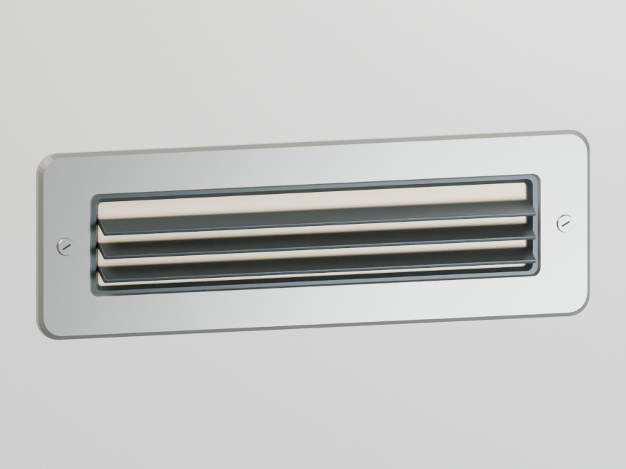

# Mall Stair Tread Light

A narrow recessed riser light has a satin nickel flange, three downward-folded graphite baffles and a warm diffuser visible between the blades.



## Placement and materials

Place the gasket on the vertical face of a riser. The metal can projects behind the riser into Blender +Y. The faceplate and louver extend toward −Y. The mount plane is Blender Y = 0 and glTF Z = 0. All dimensions are in metres. Satin nickel, graphite aluminium, black gasket and warm frosted diffuser. The riser opening needs clearance for the rear can. The baffles depict downward shielding; output and glare have not been photometrically evaluated.

## Measured geometry

The L0 envelope is 274 × 87 × 63.8 mm (width × height × depth). Both detail levels project 14.8 mm from the installation face and extend 49 mm into the riser. L1 keeps the cable port and all three shielding blades, using fewer corner facets and omitting the rear cooling fins and screw slots.

| Export | Triangles | Bytes | Materials |
| --- | ---: | ---: | ---: |
| L0 | 2,404 | 114,328 | 4 |
| L1 | 1,268 | 64,492 | 4 |

## Rebuild

From the repository root, run the following with Blender 5.1.2.

```sh
blender -b -t 2 --factory-startup --python-exit-code 1 --python models/mall-stair-tread-light/generate.py
```

The [editable Blender file](sources/mall-stair-tread-light.blend) contains 19 separately editable mesh objects. Each evaluated mesh reopened with manifold edges and positive signed volume in Blender 5.1.2. Both GLBs passed the project’s Khronos validator with zero warnings or errors. [L0](exports/optimized.glb) is the gallery model and [L1](exports/lod1.glb) is the separately generated mid-distance model. The generator shares [procedural geometry](../../scripts/mall-wall-lights.py) and [delivery code](../../scripts/mall_lighting_delivery.py) with the lighting family. To export a manual edit from the saved source, append `-- --export-source` to the command. The asset contains original procedural geometry and texture-free materials. See [asset rights](LICENSE.md).
