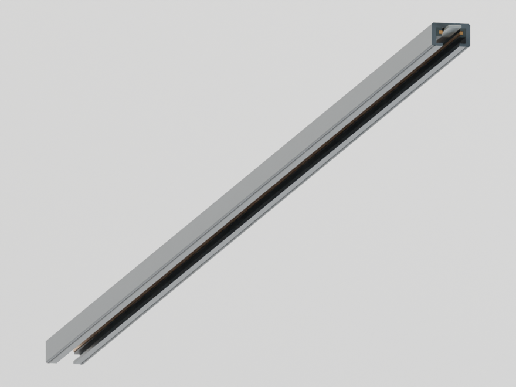
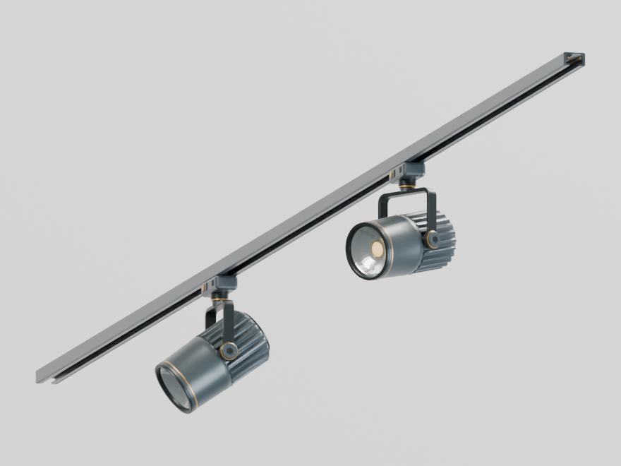

# Mall Track Light Rail

A modular 1.8 m lighting track for the [P0 lighting backlog](../../docs/shopping-mall/production-backlog-v1.md), item `MALL-LGT-005`. The extruded lower opening, copper contacts and dielectric carriers match the adapter on the [existing adjustable spotlight](../mall-track-spotlight/README.md). Four real countersunk bores pass through the top.



## Placement

1. Put the root on the ceiling underside. Local X follows the track. The 40.2 mm wide section extends about 24 mm below the ceiling.
2. Place repeated roots at **1.800 m centres**. The aluminium bodies finish at X ±899.7 mm, leaving a 0.6 mm reveal. The captive key at +X reaches 918 mm and enters the next open channel by 17.7 mm. Overall tip-to-tip length including the key is 1817.7 mm.
3. To mount a spotlight in Blender, duplicate its native root hierarchy and omit only its `Ceiling_Track` branch. Move the remaining adapter, yoke and head together to the desired X on this rail, at the same Y and Z as the rail root. The standalone spotlight GLB already includes its own short rail, baked into its visible mesh.
4. Keep the module in metre scale. Edit `Extrusion_1800`, either contact or either splice part in the native source to change the fixture. L1 omits the underside guide ribs and station indices and uses fewer segments on the crown bores.

## Assembly evidence

The repeatable check removes the 11 short-rail meshes from the saved spotlight source and retains its 50 adapter, yoke and head meshes. It exports two poses from that source, with tilt/swivel angles of 126°/0° and 104°/30°, and reimports them with two actual rails on 1.8 m centres. The head stations sit 1.28 m apart. The measured gap between their posed X extents is 1.1263 m. It checks the body gap, splice clearance, and contact on both sides of both adapters. At eight sampled points the adapter casings engage the supporting lips by 0.50 mm. The insertion foot has 0.7 mm side clearance. The same checks run on L0 and L1. These sampled visual fits apply to the two tested poses. A real installation requires the manufacturer’s load, wiring and fixing specifications.



## Build and inspect

Run from the repository root with Blender 5.1.2. The generator saves the editable [Blender file](sources/mall-track-light-rail.blend), [close-up GLB](exports/optimized.glb), [mid-distance GLB](exports/lod1.glb), hero and thumbnail. The normal build recreates the source. To preserve manual changes and re-export only L0, append `-- --export-source` to the first command.

```sh
blender --background --factory-startup --python-exit-code 1 --python models/mall-track-light-rail/generate.py
blender --background --factory-startup --python-exit-code 1 --python models/mall-track-light-rail/verify-assembly.py -- --render
```

[Metadata](metadata/mall-track-light-rail.json) · [Asset rights](LICENSE.md)
