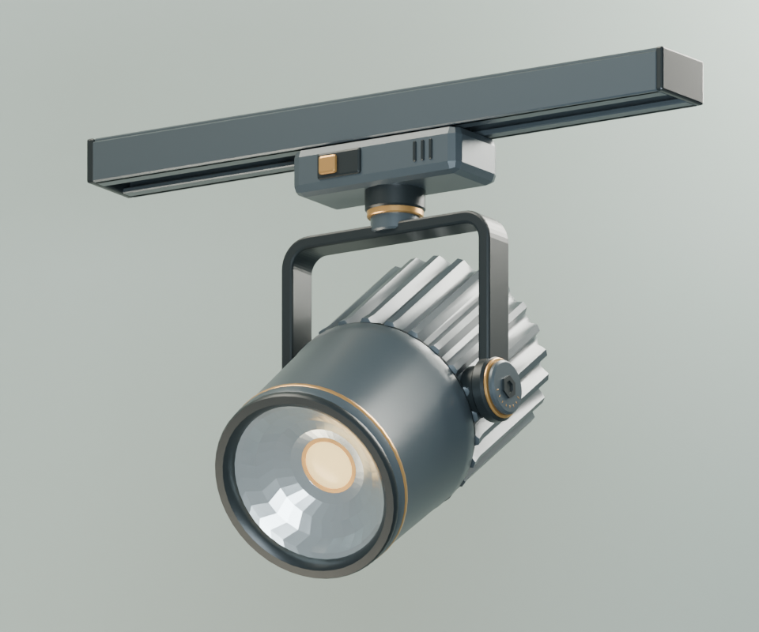

# Mall Track Spotlight

A ceiling-mounted retail spotlight for shop windows and display walls. The gallery opens below the rail so the head, hinge and recessed optic are visible together.



## Scope and placement

The gallery ID is `mall-track-spotlight`. This model covers the P0 track spotlight `MALL-LGT-006` and the adjustable-head concept in `PL-LGT-002`. The existing gallery ceiling light is a recessed square panel. This new fixture includes a short rail for mounting one head. The full-length track rail has its own backlog entry, `MALL-LGT-005`. See the [production backlog](../../docs/shopping-mall/production-backlog-v1.md) and [earlier P0 inventory](../../docs/gallery-p0-asset-inventory-2026-11-14.md).

Place the root `ASSET_MallTrackSpotlight` on the ceiling underside. Its origin is at the centre of the rail's top face. The 0.36 m rail runs along X. In the default pose the optic points down and towards Blender −Y (glTF +Z). Both detail levels use metres and the same mount. The gallery displays the close-up version. For a mid-distance scene instance, choose `exports/lod1.glb`.

The lamp is a static visual asset. Its emissive material depicts a lit lens. A scene that needs illumination must supply its own light.

## Files

| File | Use |
| --- | --- |
| [Editable Blender source](sources/mall-track-spotlight.blend) | Inspect and edit individual fixture parts |
| [Generator](generate.py) | Rebuild the asset from its construction parameters |
| [Close-up GLB](exports/optimized.glb) | Gallery viewer and close inspection |
| [Mid-distance GLB](exports/lod1.glb) | Lighter scene instances |
| [Verification](verification.md) | Measured geometry, source and browser checks |
| [Asset rights](LICENSE.md) | Authorship and reuse terms |

## Rebuild or change the aim

1. From the repository root, use Blender 5.1.2 to build the rail, adapter and swivel, then the yoke, cast housing and optics. The generator saves the editable hierarchy, exports two detail levels and renders the close-up GLB in a fresh studio scene. The example uses the Blender app on macOS. On a system with Blender on the path, set `BLENDER_BIN=blender`.

   ```sh
   BLENDER_BIN=/Applications/Blender.app/Contents/MacOS/Blender
   "$BLENDER_BIN" --background --python-exit-code 1 --python models/mall-track-spotlight/generate.py
   ```

2. To aim a copy of the saved source, rotate `Tilt_Axle` around local X to tilt the head, or rotate `Swivel_Yoke` around local Z to turn the bracket. Keep the ceiling root at its mount point. The following command exports the pose of a copy saved at `/tmp/aimed-spotlight.blend`.

   ```sh
   "$BLENDER_BIN" --background --python-exit-code 1 --python models/mall-track-spotlight/generate.py -- \
     --export-source --source /tmp/aimed-spotlight.blend --output /tmp/aimed-spotlight-glbs --skip-render
   ```

3. To check the shipped pair, use Node.js 24, install the locked dependencies with `npm ci`, then run the commands below. The fit check loads both actual GLBs and the gallery ceiling panel. It samples the top of the rail in three places and compares each sample with the panel underside.

   ```sh
   node models/mall-track-spotlight/verify-fit.mjs
   npm test
   npm run build
   ```

4. Start `npm run preview -- --port 5178` and open [the local spotlight viewer](http://127.0.0.1:5178/?model=mall-track-spotlight). With Playwright Chromium installed, the following command repeats the desktop, tablet and phone-viewport checks.

   ```sh
   MODEL_QA_ID=mall-track-spotlight MODEL_QA_INCLUDE_MOBILE=1 \
     MODEL_QA_OUTPUT=/tmp/spotlight-browser node scripts/test-model-qa-browser.mjs
   ```
