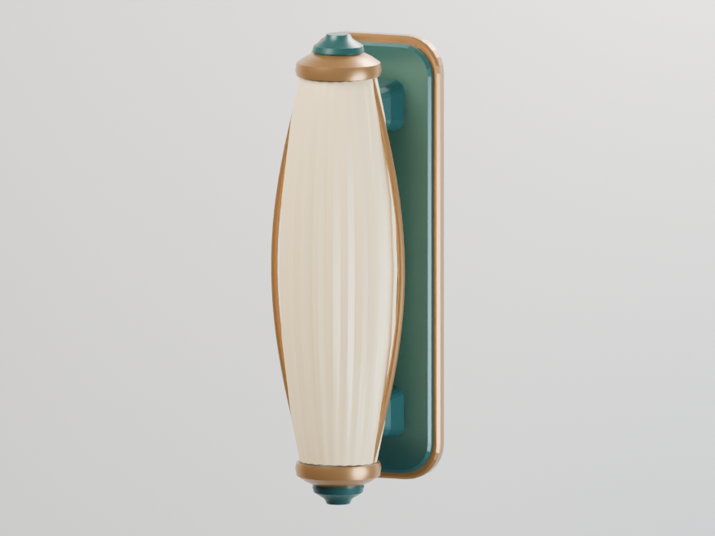

# Mall Wall Sconce

A fluted warm opal shade spans two bronze ferrules. Slim bowed guards, a peacock enamel backplate and turned finials give the wall fixture its vertical profile.



## Placement and materials

The back of the escutcheon rests against the wall. The fixture projects forward along Blender −Y. Upper and lower corbels connect the body to the backplate. The mount plane is Blender Y = 0 and glTF Z = 0. All dimensions are in metres. Satin bronze, peacock enamel, dark saddle lining and warm ribbed opal. A static decorative luminaire with a modelled opal shade.

## Measured geometry

The L0 envelope is 109.3 × 362 × 129.6 mm (width × height × depth). Both detail levels project 129.6 mm from the installation face. L1 reduces the flute count and segmentation of the bowed side guards, collars and backplate corners.

| Export | Triangles | Bytes | Materials |
| --- | ---: | ---: | ---: |
| L0 | 6,572 | 197,692 | 4 |
| L1 | 2,420 | 77,820 | 4 |

## Rebuild

From the repository root, run the following with Blender 5.1.2.

```sh
blender -b -t 2 --factory-startup --python-exit-code 1 --python models/mall-wall-sconce/generate.py
```

The [editable Blender file](sources/mall-wall-sconce.blend) contains 19 separately editable mesh objects. Each evaluated mesh reopened with manifold edges and positive signed volume in Blender 5.1.2. Both GLBs passed the project’s Khronos validator with zero warnings or errors. [L0](exports/optimized.glb) is the gallery model and [L1](exports/lod1.glb) is the separately generated mid-distance model. The generator shares [procedural geometry](../../scripts/mall-wall-lights.py) and [delivery code](../../scripts/mall_lighting_delivery.py) with the lighting family. To export a manual edit from the saved source, append `-- --export-source` to the command. The asset contains original procedural geometry and texture-free materials. See [asset rights](LICENSE.md).
