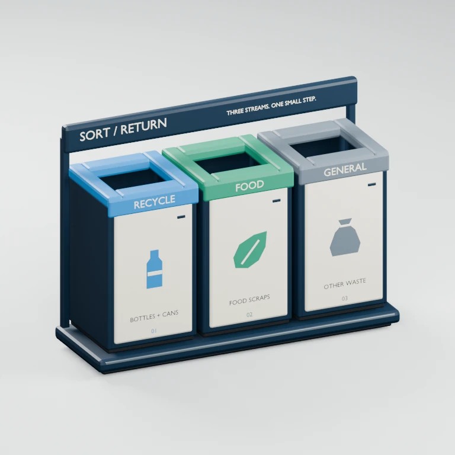

# Mall Waste Sorting Station

An original **SORT / RETURN** three-stream station, distinct from the gallery's existing single waste bin. Blue recycling, jade food waste and slate general waste are visible through both color and editable labels, with solid bottle, leaf and refuse-bag pictograms.



## Delivered asset

- Editable Blender 4.0.2 source, standalone texture-free GLB, PNG and WebP previews.
- 1.90 × 0.63 × 1.35 m in Blender XYZ, with its origin at the floor centre.
- Front: Blender +Y / glTF -Z. Existing per-asset `previewRotationY: Math.PI` presents the labelled side initially. No viewer changes.
- Seven independent mesh-bearing GLB modules: `StationFrame`, three `Recycle/Food/GeneralCompartment` bodies and three `Recycle/Food/GeneralLid` inserts.
- Each body has its own walls and recessed liner bottom. Four rim rails form each genuine 0.38 × 0.34 m aperture. These are not black decals over a solid top.
- Static scene asset. The gallery supports orbit, zoom and reset, not runtime recycling, live label replacement, opening doors or animated lids.

## Edit labels, colors or modules

1. Open `sources/mall-waste-sorting-station.blend`.
2. Edit the FONT object `Recycle editable stream label` (or its Food/General equivalent) inside the corresponding Lid collection. Detail labels and pictograms live in each Compartment collection; title text lives in `StationFrame`.
3. Move, replace or duplicate a complete named collection for source-level layout changes. Each exported module remains independently addressable under `ASSET_MallWasteSortingStation`.
4. Save the source and re-export **without rebuilding**:

   ```sh
   blender --background --python models/mall-waste-sorting-station/generate.py -- --export-source
   python3 models/mall-waste-sorting-station/prepare_previews.py
   node models/mall-waste-sorting-station/validate.mjs
   ```

Export evaluates bevels and editable FONT geometry, joins only within semantic modules, and excludes the studio. Rebuilding without `--export-source` overwrites manual source edits. Keep a separate copy first. Long labels may need manual resizing/repositioning; there is no automatic fitting.

After editing, synchronize metadata metrics/validation with `reports/assets.json`, and update source-inspection expectations if the canonical labels intentionally change.

## Rebuild and verify

```sh
blender --background --python models/mall-waste-sorting-station/generate.py
blender --background --python models/mall-waste-sorting-station/inspect_sources.py
python3 models/mall-waste-sorting-station/prepare_previews.py
node models/mall-waste-sorting-station/validate.mjs
# Choose a new output directory for the destructive edit test's isolated copy:
blender --background --python models/mall-waste-sorting-station/test_source_edit.py -- /tmp/sorting-edit-check
node models/mall-waste-sorting-station/verify_source_edit.mjs /tmp/sorting-edit-check
npm test
npm run build
node scripts/test-mall-waste-sorting-station.mjs
npm run test:library
```

Blender 4.0.2, Python with Pillow, Node 22 and pinned project dependencies are used. Browser checks use Playwright Chromium. `MALL_QA_DIR` selects focused screenshot/report output. The isolated source-edit check changes RECYCLE to PLASTIC, validates the actual new GLB and proves that only `RecycleLid` changes while the original asset and six sibling modules remain unchanged.

## Budgets and provenance

11,508 triangles, 22 primitives, seven materials and no textures or animations. Exact bytes/SHA are in the metadata and report. The 22 primitives intentionally exceed the preferred eight-primitive target to preserve the seven independent semantic modules and their material slots. Hard budgets: 700,000 bytes, 20,000 triangles, 26 primitives.

All geometry, materials and labels are original to this project; editable text uses Blender's bundled Bfont. No downloaded models, textures or branded artwork. Reuse in the owner's projects is authorized; public redistribution terms remain unspecified and the gallery download control stays disabled.

This is a decorative concept, not a certified waste system, local sorting standard, fabrication design or accessibility specification. Adapt streams, colors and accepted items to local rules. See [verification](verification.md) for measured evidence and limitations.
