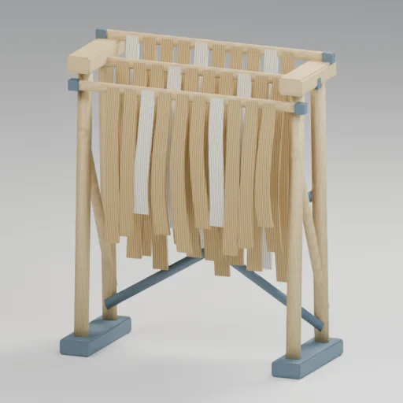

# Noodle Loom

S06 · Flying Wheel · Air-drying workshop. Slatted noodle-drying loom.

Bottom centre of the installed envelope, +Y up and +Z display front in glTF.

Low 540 triangles | Balanced 1,376 triangles | Detailed 2,580 triangles.

[Editable source](sources/noodle-loom.blend) · [Generator](generate.py) · [Measurements and provenance](metadata/noodle-loom.json) · [Rights](LICENSE.md)

[Build instructions and placement contract](../../docs/gjh-v11-interiors-build.md)
