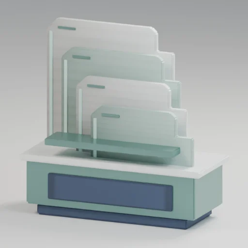

# Opal Index

S12 · Zeria · Quiet dispensary. Layered opal index-fin island.

Bottom centre of the installed envelope, +Y up and +Z display front in glTF.

Low 232 triangles | Balanced 824 triangles | Detailed 1,240 triangles.

[Editable source](sources/opal-index.blend) · [Generator](generate.py) · [Measurements and provenance](metadata/opal-index.json) · [Rights](LICENSE.md)

[Build instructions and placement contract](../../docs/gjh-v11-interiors-build.md)
