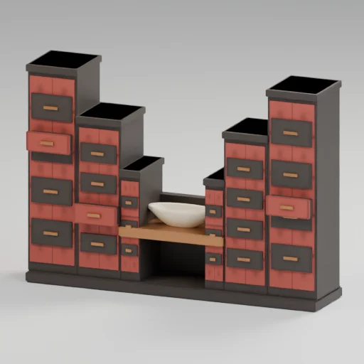

# Specimen Drawers

S05 · Pien Tze Huang · Herbal counting house. Stepped drawer bank with open porcelain niche.

Bottom centre of the installed envelope, +Y up and +Z display front in glTF.

Low 500 triangles | Balanced 1,764 triangles | Detailed 2,228 triangles.

[Editable source](sources/specimen-drawers.blend) · [Generator](generate.py) · [Measurements and provenance](metadata/specimen-drawers.json) · [Rights](LICENSE.md)

[Build instructions and placement contract](../../docs/gjh-v11-interiors-build.md)
