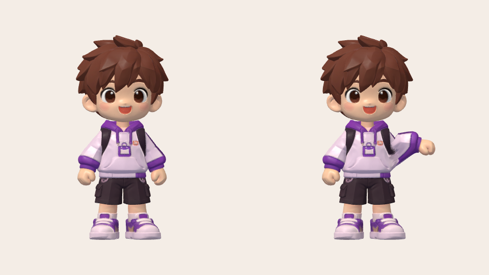

# Tripo chibi rig preview

The character is registered in the gallery under **People & Characters**. Open `?page=models&model=tripo-chibi-rig` to rotate it, raise its left arm, toggle the skeleton overlay, or reset the pose. The GLB includes baked tangents for its normal map.

The GLB contains the front-facing figure extracted from a three-figure Tripo export, its original color, normal and roughness/metallic textures, and a locally created 21-joint humanoid rig. The arm test compares the rest pose and a 58-degree left-arm raise. The inner sleeve and backpack strap stretch at this angle.



From the repository root, run `npm ci` and `python3 -m http.server 8000 --bind 127.0.0.1`, then open [the local viewer](http://127.0.0.1:8000/models/tripo-chibi-rig/). Drag to orbit, scroll to zoom and use the two buttons to toggle the arm pose and skeleton overlay.

To reproduce the rig from the original Tripo GLB (asset ID `6606d099-44f5-487d-88c1-3109d76ec207`), use Python with NumPy and SciPy. The extraction and joint positions are specific to this source layout.

```sh
python3 models/tripo-chibi-rig/extract.py original.glb build-chibi
python3 models/tripo-chibi-rig/rig.py build-chibi/front-character.glb
```

The output is `build-chibi/rigged-character.glb`.

## Download encoding

The gallery GLB uses losslessly recompressed PNG maps at the original resolution. See the [encoding receipt and rebuild procedure](../../docs/verification/model-downloads/README.md). Run that encoding step after a fresh source export to reproduce the smaller delivery.
